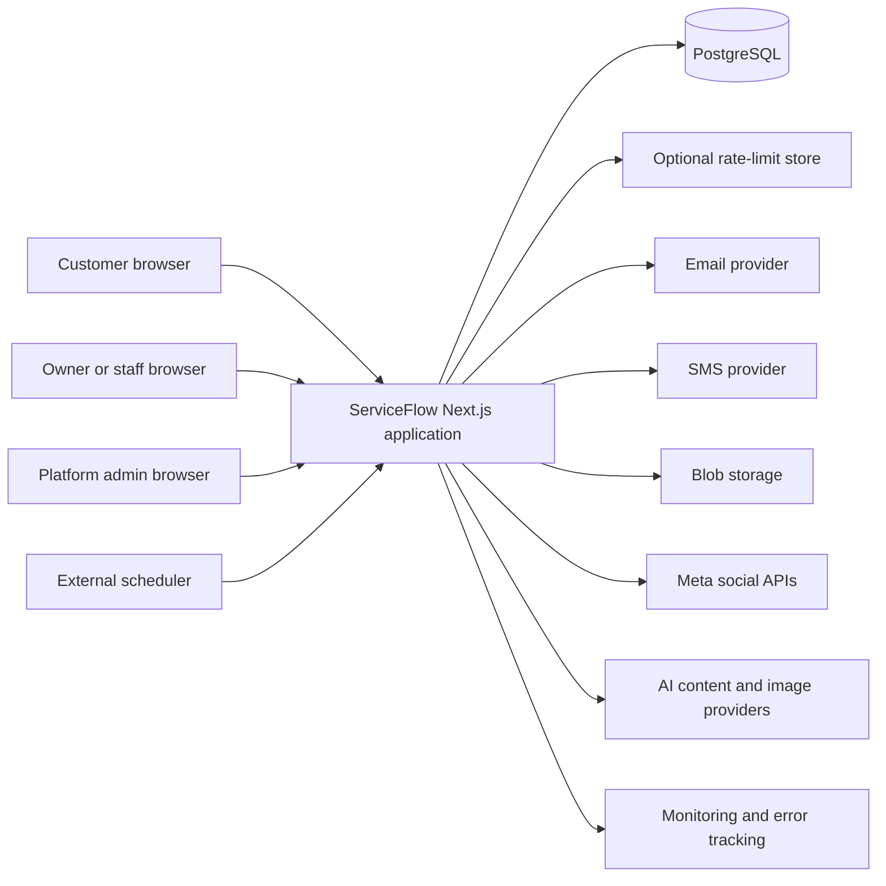
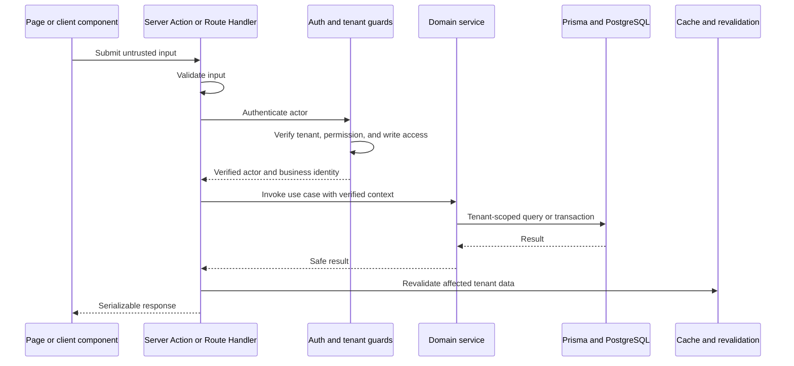
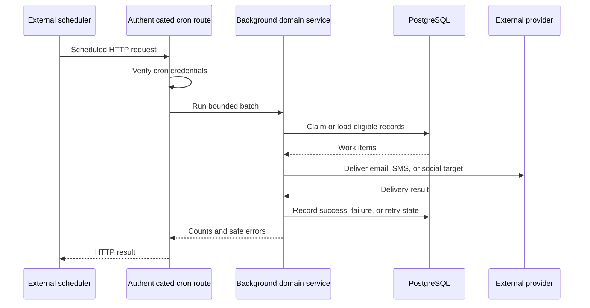
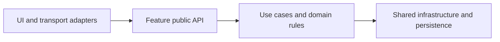

# ServiceFlow Architecture

Status: living document

Last verified: 2026-09-16

Audience: engineers and coding agents working in this repository

## Purpose

This document describes the architecture implemented today and the target
architecture for incremental cleanup. Sections labeled **Current** are verified
against the repository. Sections labeled **Target** are rules for new and
modified code; they do not claim that all legacy code already complies.

ServiceFlow is a multi-tenant modular monolith for service businesses. It keeps
one Next.js application and one PostgreSQL database while separating public
booking, tenant operations, and platform administration through routing,
authentication, authorization, and tenant-scoped data access.

## System Context — Current



The application can run as a Vercel deployment or as the Node.js application
built by the repository Dockerfile. Scheduled work is invoked through
authenticated HTTP endpoints rather than an in-process worker. Provider choices
are configuration details; the architectural boundary is the integration
adapter, not a specific host.

## Runtime and Application Surfaces — Current

| Area | Responsibility |
| --- | --- |
| Next.js 16 App Router | Routing, React Server Components, layouts, metadata, Server Actions, and Route Handlers |
| React 19 | Interactive client UI and server-rendered UI |
| NextAuth | Credential login, onboarding magic-link login, JWT-backed sessions, and session projection |
| Prisma 7 and PostgreSQL | Relational persistence, transactions, constraints, migrations, and generated types |
| Next.js cache APIs | Cached reads and tenant-specific revalidation tags |
| Vitest | Unit, component, Route Handler, and database integration tests |
| Playwright | Browser smoke and workflow tests |
| Sentry | Client, server, and edge observability |

The main user-facing surfaces are:

- Public marketing, onboarding, referral, business storefront, service,
  booking, booking-management, and gift-card routes.
- Authenticated tenant workspaces under `/app/[businessSlug]` for bookings,
  customers, catalog, staff, attendance, payroll, reports, growth, billing, and
  social workflows.
- Platform administration under `/platform` for applications, businesses,
  plans, invoices, referrals, audit records, and outbox inspection.
- Route Handlers under `/api` for authentication, health, upload, report export,
  public QR data, social connection callbacks, and cron execution.

## Request and Security Boundaries — Current

`proxy.ts` is the first application boundary for matched routes. It protects
tenant and platform pages, redirects users by role and tenant, rejects invalid
sessions, and rate-limits API requests. Authentication is repeated inside
server-side boundaries; proxy checks are not treated as sufficient authorization.

NextAuth supports contact-number/password credentials and a single-use
onboarding magic-link credential flow. The session includes the user role,
business slug, password-change state, and platform-admin state. Tenant helpers
resolve the authenticated actor, verify the requested business, enforce staff
permissions, and apply subscription read-only restrictions to writes.

An authenticated tenant mutation follows this required flow:



The normative controls, file placement, response contract, and review checklist
for this sequence are defined in
[`docs/application-boundaries.md`](docs/application-boundaries.md). The tracked
UI persistence inventory and migration order are in
[`docs/prisma-ui-inventory.md`](docs/prisma-ui-inventory.md).

Supporting invariants are documented in
[`docs/transaction-boundaries.md`](docs/transaction-boundaries.md),
[`docs/tenant-isolation.md`](docs/tenant-isolation.md),
[`docs/authorization.md`](docs/authorization.md), and
[`docs/integration-inventory.md`](docs/integration-inventory.md).

Public actions do not have an authenticated tenant session. They must instead
resolve the business from validated public identifiers and apply the public-flow
controls appropriate to the operation, such as signed tokens, OTP checks,
idempotency, expiry, rate limiting, or ownership verification.

## Data and Persistence — Current

`prisma/schema.prisma` is the relational source of truth. The schema covers
businesses and users, staff and permissions, catalog, customers and bookings,
attendance and payroll, billing and referrals, growth and campaigns, social
publishing, gift cards, audit records, and queued outbox messages.

Most business-owned models carry `business_id` and supporting indexes. Tenant
isolation is an application invariant: authenticated identity is resolved first,
then tenant-owned reads and writes are scoped to the verified business. Database
constraints provide additional integrity for relations, uniqueness, scheduling,
and other storage-level invariants.

The shared Prisma client lives in `prisma/prisma.ts`. It selects the configured
connection mode, limits connection pools for serverless environments, reuses the
client in development, and retries a restricted set of transient read failures.
Schema changes use additive Prisma migrations; committed migrations are
immutable.

Some reads use Next.js caching with tenant-specific tags. Mutations must
revalidate affected paths or tags. Multi-write operations that represent one
business outcome must use a database transaction. Material operations may also
write audit records or enqueue outbox messages in the same transaction.

## Background Work and Integrations — Current

Cron Route Handlers authenticate requests using a bearer secret or HTTP Basic
credentials. They cover booking conflicts, expired holds, reminders,
re-engagement, flow reminders, daily growth work, outbox processing,
subscription renewals, dunning, and referral rewards.



The transactional outbox separates committing business events from delivery.
Immediate delivery may be attempted, but failed work remains persisted for the
normal cron processor to retry. Handlers must be safe under retries and avoid
duplicating externally visible effects.

Integration boundaries currently include:

- Transactional email and SMS/OTP delivery.
- Blob-backed uploads and brand/reference assets.
- Meta OAuth and social target delivery.
- AI-assisted captions, prompts, and promotional image generation.
- QR image generation and manual GCash verification workflows.
- Optional remote rate-limit storage with an in-memory fallback policy.
- Sentry instrumentation for client, server, and edge runtimes.
- External HTTP scheduling for operational jobs.

Secrets stay in server-only configuration. Routes and logs must not expose
credentials, provider tokens, raw internal errors, or customer-sensitive data.

## Code Organization — Current

The repository is a feature-first modular monolith with remaining incremental
cleanup:

- `app/` contains routes, layouts, rendering, and thin transport adapters.
- `components/` contains shared and feature UI with no direct Prisma access.
- `features/` owns domain actions, schemas, services, queries, repositories,
  types, and colocated tests.
- Feature-owned action boundaries live under `features/<domain>/actions/`.
  Transitional cross-feature infrastructure and some older domain services
  remain under `lib/` and move only when safely touched.
- `prisma/` contains the schema, migrations, shared client, seed, manual SQL,
  and generated client.
- Unit tests are usually colocated, while shared setup, database integration,
  and Playwright tests live under the canonical `test/` hierarchy.

Known debt includes eight Route Handlers whose direct Prisma access must remain
thin, transitional services under `lib/`, and recurring unused-code review.
These are migration inputs, not patterns to copy.

## Target Architecture

The target is a feature-first modular monolith. It deliberately retains one
Next.js deployment and one PostgreSQL database. Microservices, independent
databases, and a separate queue platform are not current goals.

```text
app/                         Routing, rendering, and thin transport adapters
features/<domain>/           Public feature API, use cases, validation, queries,
                              domain types, provider adapters, and colocated tests
components/ui/               Shared presentation primitives with no DB access
lib/                         Cross-feature infrastructure only
prisma/                      Schema, migrations, shared client, and generated code
test/integration/            Real-database cross-boundary verification
test/e2e/                    Playwright user-flow verification
```

Dependencies flow inward in one direction:



Feature modules may use shared infrastructure, but they must not import another
feature's internals. Cross-feature calls go through the owning feature's public
API. UI and transport adapters do not contain domain decisions. Shared UI does
not access Prisma. Infrastructure does not import application UI.

Every protected write must perform, in order: boundary validation,
authentication, tenant authorization, permission and subscription-write checks,
domain validation, and transactional persistence where atomicity is required.
Responses crossing to clients must be serializable and safe.

## Migration Strategy

Migration is incremental:

1. Identify the owning domain when changing legacy code.
2. Add or use a feature public API for the touched use case.
3. Move the smallest coherent unit of validation, business logic, and data
   access when imports and tests can be updated within the task.
4. Leave pages, Route Handlers, and Server Actions as thin adapters.
5. Add characterization tests before moving fragile behavior.
6. Avoid repository-wide moves that mix unrelated domains or hide behavior
   changes inside structural work.

Changes to deployment topology, tenant-isolation strategy, authentication model,
database ownership, asynchronous delivery semantics, or cross-feature dependency
rules require an Architecture Decision Record before implementation.

The accepted feature-first ownership and dependency decision is recorded in
[`docs/decisions/0001-feature-first-modular-monolith.md`](docs/decisions/0001-feature-first-modular-monolith.md).

## Verification Expectations

Architecture changes must follow `AGENTS.md`. At minimum, application changes
run lint, typecheck, and focused tests. Routing or production-boundary changes
also run the application build. Database changes validate Prisma and run relevant
integration tests. User-flow changes run the affected Playwright suite.

Update this document when a change makes any **Current** section inaccurate or
when an accepted ADR changes the target architecture.
